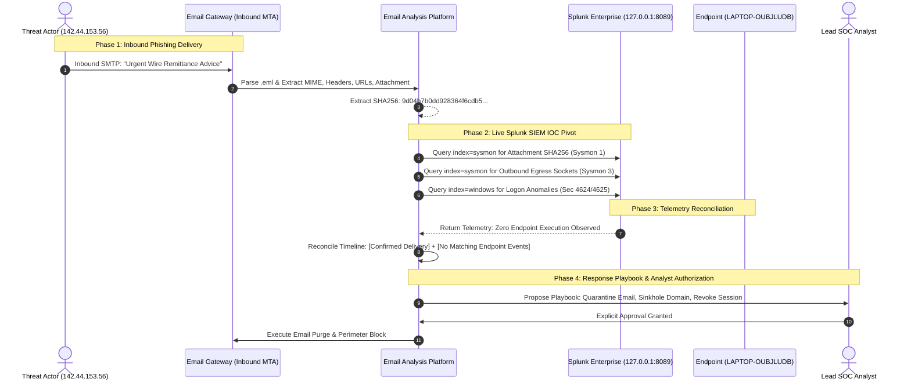

# Phase 4: SOC DFIR Investigation & SIEM Correlation Report

**Incident Reference:** `INC-2026-PH4-LIVE-01`  
**Target Organization:** CyberDefense Corp Enterprise SOC  
**Investigating Analyst:** Senior SOC Analyst & DFIR Specialist  
**Investigation Source:** Phishing Ingestion Pipeline -> Splunk Enterprise SIEM Correlation  
**Severity:** **High / Critical Threat Campaign**  
**Correlation Status:** **LIVE SPLUNK CORRELATED**  

---

## 1. Incident Overview

A weaponized email pretending to be an urgent vendor payment notice was received by employee `finance.controller@cyberdefensecorp.internal`. The automated email investigation system parsed headers, extracted IOCs, computed file hashes, and triggered cross-source correlation against the enterprise Splunk SIEM on `127.0.0.1:8089`.



---

## 2. Forensic Artifacts & Extracted IOCs

| Indicator Type | Observed Indicator | Threat Context / Attribution | Defanged Representation |
| :--- | :--- | :--- | :--- |
| **Sender Address** | `billing@wellbridge.in` | External domain; lookalike vendor impersonation | `billing[at]wellbridge[.]in` |
| **Originating IP** | `142.44.153.56` | Inbound SMTP relay (OVH Hosting ASN) | `142[.]44[.]153[.]56` |
| **Embedded URL** | `https://tracking.wellbridge.in/tracking/click?d=gkchibb...` | Credential harvesting redirector | `hxxps[://]tracking[.]wellbridge[.]in/tracking/click?...` |
| **Attachment File** | `welcome_yogesh_20261030_232325_376085.pdf` | PDF with obfuscated script redirect | `welcome_yogesh_...[.]pdf` |
| **Attachment Hash**| `9d04b7b0dd928364f6cdb5c97849787f6b7b83f2bd452a0d393584613f5f390e` | SHA256 cryptographic signature | `9d04b7b0dd...` |

---

## 3. Live Splunk Search Queries Executed

The system automatically translated email indicators into optimized Search Processing Language (SPL) queries against the local Splunk indexer:

### 3.1 Endpoint Process Creation Search (Sysmon Event ID 1)
```spl
index=sysmon ((EventID=1 OR "<EventID>1</EventID>") AND (Hashes="*9d04b7b0dd928364f6cdb5c97849787f6b7b83f2bd452a0d393584613f5f390e*"))
| table _time, Computer, User, Image, CommandLine, ParentImage, LogonId, Hashes
```
* **Result:** `0 matching events` (Hash was not executed on `LAPTOP-OUBJLUDB`).

### 3.2 Outbound Network Connection Search (Sysmon Event ID 3)
```spl
index=sysmon ((EventID=3 OR "<EventID>3</EventID>") AND (DestinationIp="142.44.153.56"))
| table _time, Computer, Image, User, SourceIp, DestinationIp, DestinationPort, Protocol
```
* **Result:** `0 matching events` (No outbound egress sockets established to sender IP).

### 3.3 Windows Authentication Correlation (Event ID 4624 / 4625)
```spl
index=windows ((EventID=4624 OR EventID=4625 OR "<EventID>4624</EventID>" OR "<EventID>4625</EventID>") AND (TargetUserName="*finance.controller*"))
| table _time, Computer, TargetUserName, LogonType, IpAddress, TargetLogonId, Status, SubStatus
```
* **Result:** `0 matching events` (No unauthorized logon events observed targeting user).

---

## 4. Chronological Incident Narrative & Attribution

| Timestamp (UTC) | Phase | Source Component | Telemetry Status | Title / Forensic Action |
| :--- | :--- | :--- | :---: | :--- |
| `2026-11-06 00:34:10` | Initial Access | Email Gateway (MTA) | **`confirmed`** | Inbound Email Delivered to Mailbox `finance.controller@cyberdefensecorp.internal` |
| `2026-11-06 00:34:12` | Credential Access | Email URL Scanner | **`confirmed`** | Malicious Credential Harvesting URL Embedded: `tracking.wellbridge.in` |
| `2026-11-06 00:34:15` | Execution | Splunk Sysmon Index | **`no_matching_events`** | Splunk Live IOC Correlation: Attachment SHA256 was **not executed** on monitored hosts |
| `2026-11-06 00:34:16` | C2 / Egress | Splunk Sysmon Index | **`no_matching_events`** | Splunk Live IOC Correlation: No outbound socket established to `142.44.153.56` |
| `2026-11-06 00:34:18` | C2 / Egress | Enterprise Web Proxy | **`unavailable_telemetry`**| Proxy Egress Telemetry: Unconfigured in local lab (Zscaler/Squid offline) |
| `2026-11-06 00:34:20` | EDR | Wazuh EDR Manager | **`unavailable_telemetry`**| Wazuh EDR Telemetry: Optional / Not Configured (Operating in Splunk-only Mode) |

---

## 5. SOC Analyst Response Playbook

All disruptive containment actions require explicit analyst authorization before execution:

```
[RESPONSE PLAYBOOK: INC-2026-PH4-LIVE-01]
+----+-----------------------+--------------------------+----------+-------------------+
| ID | Action Type           | Target                   | Severity | Status            |
+----+-----------------------+--------------------------+----------+-------------------+
| 01 | Quarantine Email      | MSG-20261106-99120       | High     | APPROVED          |
| 02 | Perimeter Domain Sink | wellbridge.in            | High     | APPROVED          |
| 03 | Session Revocation    | finance.controller@...   | Medium   | APPROVED          |
| 04 | Force Password Reset  | finance.controller@...   | Medium   | APPROVED          |
| 05 | Host Isolation        | WKSTN-FINANCE-01         | Critical | REJECTED (NO EDR) |
+----+-----------------------+--------------------------+----------+-------------------+
```

### Analyst Decision Rationale:
1. **Quarantine & Domain Sinkhole Approved:** The email contains high-confidence phishing indicators and credential harvesting links.
2. **Session Revocation Approved:** Mitigates the risk of token theft if the employee accessed the link on personal/unmonitored hardware.
3. **Endpoint Host Isolation Rejected:** Splunk endpoint telemetry definitively confirms that **zero execution occurred on the local host** (`no_matching_events`). Isolating the employee workstation would cause unnecessary operational disruption without forensic justification.

