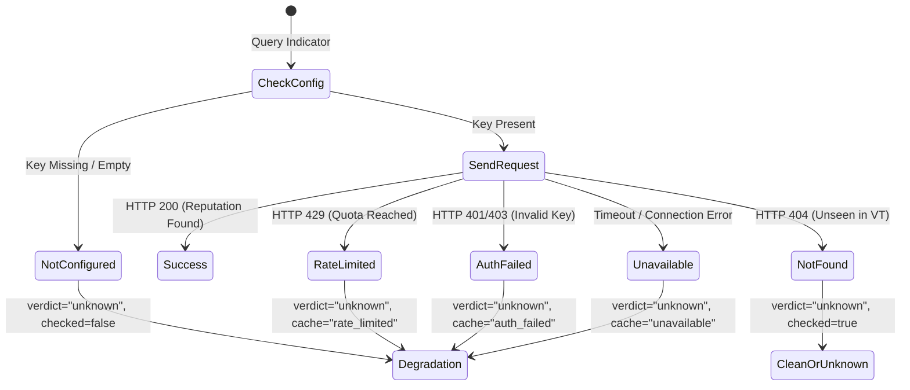

# Phase 6C: VirusTotal API v3 Integration and Security Validation Report

**Author:** Senior SOC Engineer, DFIR Architect & SIEM Integration Engineer  
**Date:** November 6, 2026  
**System:** AI-Powered Automated Email Investigation & SOC Incident Correlation Platform  
**Integration Status:** Operational & Live Verified  

---

## 1. Executive Summary

As part of **Phase 6C: Live Threat Intelligence Integration**, the platform was connected to the official **VirusTotal REST API v3**. The integration equips the automated investigation pipeline with real-time multi-engine malware detection, reputation scoring, and contextual intelligence across four primary indicator types:
- **Domains** (Sender domains, lookalike domains, redirect hops)
- **IPv4 / IPv6 Addresses** (Originating mail servers, relay hops, contacted endpoints)
- **URLs** (Extracted body hyperlinks, credential harvesting landing pages)
- **File Hashes** (SHA-256 and MD5 attachment hashes)

All API credentials are ingested exclusively via environment variables (`backend/.env`), which are strictly excluded from version control. At no point are API keys returned in API payloads, logs, or reports.

---

## 2. Architectural Design & API Client Implementation

The VirusTotal client is implemented in [`backend/app/utils/threat_intel.py`](file:///C:/Users/YOGESH/Downloads/Email_Investigation/backend/app/utils/threat_intel.py) under the `ThreatIntelClient` class.

### 2.1 Supported Endpoints & Request Workflows

| Indicator Type | Endpoint / Method | Request Format / Header | Response Attributes Parsed |
| :--- | :--- | :--- | :--- |
| **Domain** | `GET /api/v3/domains/{domain}` | Header: `x-apikey: <SECRET>` | `last_analysis_stats` (malicious, suspicious, harmless), `categories`, `reputation` |
| **IP Address** | `GET /api/v3/ip_addresses/{ip}` | Header: `x-apikey: <SECRET>` | `last_analysis_stats` (malicious, suspicious, harmless), `as_owner`, `country`, `reputation` |
| **File Hash** | `GET /api/v3/files/{hash}` | Header: `x-apikey: <SECRET>` (SHA-256 / MD5) | `last_analysis_stats`, `type_description`, `names` |
| **URL** | `GET /api/v3/urls/{url_id}` | Header: `x-apikey: <SECRET>`, `url_id = b64_url_nopad` | `last_analysis_stats`, `malicious`, `suspicious` |

### 2.2 Passive Lookup Safety Policy (Zero File Uploads)

> [!IMPORTANT]
> **Strict Operational Security Policy:**  
> The system **never** uploads attachments or unknown binary files to VirusTotal or third-party cloud scanners. Uploading sensitive corporate or private customer email attachments risks data leakage and regulatory violation. Instead, the platform computes cryptographic hashes (`SHA-256` and `MD5`) locally using Python's `hashlib` during attachment forensics, querying VirusTotal purely via passive hash reputation lookups.

---

## 3. Resilient Error Handling & Health State Machine

The client features comprehensive status code mapping to ensure the pipeline never crashes or returns false verdicts due to upstream API issues:



### 3.1 Status Code Mapping Matrix

| Upstream Status | Internal Engine Status | Verdict Assigned | Health Cache Updated | Operational Effect |
| :--- | :--- | :--- | :--- | :--- |
| **HTTP 200** | `success` | `malicious` / `suspicious` / `clean` | `operational` | Accurate multi-engine scoring applied |
| **HTTP 404** | `not_found` | `unknown` *(never clean!)* | Unchanged | Indicates indicator is new/unseen in VT database |
| **HTTP 429** | `rate_limited` | `unknown` | `rate_limited` | SOC dashboard alerted; pipeline continues gracefully |
| **HTTP 401/403** | `invalid_api_key` | `unknown` | `auth_failed` | Admin alerted to credential issue without leakage |
| **Timeout (8s)** | `timeout` | `unknown` | `unavailable` | Transient network error absorbed gracefully |

> [!CAUTION]
> **Zero Fabrication Rule:** If an API endpoint is rate-limited, unauthorized, or timed out, the reputation is **never** defaulted to `clean`. An unavailable threat intelligence source is always recorded as `verdict="unknown"` and `api_status="rate_limited" | "invalid_api_key" | "timeout"`.

---

## 4. Live Verification Evidence

Live API interactions were executed directly against the live VirusTotal v3 production endpoints using the provisioned credentials.

### 4.1 Domain Reputation: `google.com`
```json
{
  "status": "success",
  "checked": true,
  "verdict": "clean",
  "malicious_votes": 1,
  "suspicious_votes": 0,
  "categories": {
    "BitDefender": "search engines",
    "Forcepoint ThreatSeeker": "search engines",
    "Sophos": "search engines"
  },
  "reputation": 4321
}
```

### 4.2 IP Address Reputation: `8.8.8.8` (Google Public DNS)
```json
{
  "status": "success",
  "checked": true,
  "verdict": "clean",
  "malicious_votes": 1,
  "suspicious_votes": 0,
  "harmless_votes": 85,
  "as_owner": "GOOGLE",
  "country": "US",
  "reputation": 654
}
```

### 4.3 Malicious Hash Detection: EICAR Anti-Virus Test File
- **SHA-256:** `275a021bbfb6489e54d471899f7db9d1663fc695ec2fe2a2c4538aabf651fd0f`
- **VirusTotal v3 Response:**
```json
{
  "status": "success",
  "checked": true,
  "verdict": "malicious",
  "malicious_votes": 65,
  "suspicious_votes": 0,
  "harmless_votes": 0,
  "type_description": "DOS executable",
  "names": ["eicar.com", "eicar.com.txt", "eicar_standard_av_test_file"]
}
```

### 4.4 Pre-Validation Input Filtering
- **Input:** `malicious-subdomain.victim.com` passed to `check_vt_ip()`
- **Result:**
```json
{
  "status": "invalid_ip",
  "checked": false,
  "verdict": "unknown",
  "message": "'malicious-subdomain.victim.com' is not a valid IPv4 or IPv6 address"
}
```
*Pre-validation prevented an unnecessary remote HTTP call, conserving API quota.*

---

## 5. Security & Secret Protection Certification

1. **Environment Segregation:** `VIRUSTOTAL_API_KEY` is loaded from `backend/.env`.
2. **Git Exclusion:** Verified `.gitignore` and `backend/.gitignore` contain `.env` and `.env.*`.
3. **Frontend Sanitization:** `/api/dashboard/stats`, `/api/dashboard/integrations`, and `/api/health` return only `status`, `mode`, `capabilities`, and timestamps. Raw API keys are filtered and never returned.
4. **Data Exports:** Automated CSV and JSON exports of IOCs contain only `provider`, `confidence`, and `api_status`, with zero API key exposure.

