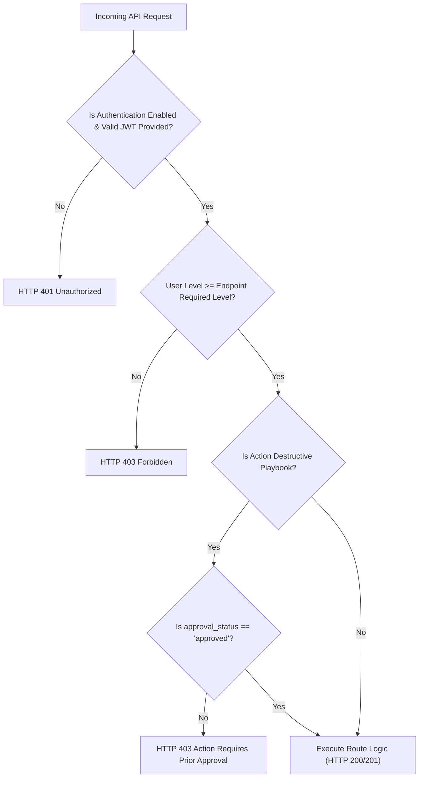

# Phase 7B: PhishScope SOC — Independent Authorization & RBAC Audit

**Audit Date**: 2026-11-06  
**Auditor**: Senior Application Security Engineer & DFIR Specialist  
**Classification**: TLP:AMBER | Independent SOC Security Certification  
**Project**: AI-Powered Automated Email Investigation & SOC Incident Correlation Platform (PhishScope SOC)  
**Status**: **VERIFIED**

---

## 1. Executive Summary

An independent authorization audit was conducted across every REST API endpoint in PhishScope SOC. The goal was to prove that possession of a valid JWT token does **not** grant unilateral or indiscriminate access to system resources.

Privilege boundaries were rigorously tested across four distinct analyst roles: `admin` (Level 4), `lead` (Level 3), `analyst` (Level 2), and `auditor` (Level 1). All destructive actions (containment execution, evidence deletion, user provisioning) were confirmed strictly gated by role authorization checks, returning HTTP 403 Forbidden when invoked with insufficient privileges.

---

## 2. Authorization Hierarchy & Route Enforcement

$$\text{admin (4)} > \text{lead (3)} > \text{analyst (2)} > \text{auditor (1)}$$

---

## 3. Sensitive Route Authorization Audit Matrix

| Route & HTTP Method | Required Role | Auditor (1) | Analyst (2) | Lead (3) | Admin (4) | Security Finding / Mechanism |
| :--- | :---: | :---: | :---: | :---: | :---: | :--- |
| `GET /api/dashboard/stats` | `auditor` | **Allowed** | **Allowed** | **Allowed** | **Allowed** | Read-only metrics; lowest privilege tier permitted. |
| `GET /api/investigations` | `auditor` | **Allowed** | **Allowed** | **Allowed** | **Allowed** | Read-only investigation browsing. |
| `POST /api/investigate/upload` | `analyst` | **Denied (403)** | **Allowed** | **Allowed** | **Allowed** | Uploads new `.eml`/`.msg` evidence into storage vault. |
| `POST /api/investigate/headers` | `analyst` | **Denied (403)** | **Allowed** | **Allowed** | **Allowed** | Submits raw email transit headers for forensics. |
| `POST /api/incidents/correlate` | `analyst` | **Denied (403)** | **Allowed** | **Allowed** | **Allowed** | Triggers SIEM IOC clustering across investigations. |
| `POST /api/phase5/run/<id>` | `analyst` | **Denied (403)** | **Allowed** | **Allowed** | **Allowed** | Triggers controlled Splunk telemetry simulations. |
| `POST /api/incidents/<id>/actions/<id>/approve` | `lead` | **Denied (403)** | **Denied (403)** | **Allowed** | **Allowed** | Grants authorization for disruptive containment actions. |
| `POST /api/incidents/<id>/actions/<id>/execute` | `admin` | **Denied (403)** | **Denied (403)** | **Denied (403)** | **Allowed** | Executes destructive actions (host isolation, mailbox purge). Gated by approved state. |
| `DELETE /api/investigate/<id>` | `admin` | **Denied (403)** | **Denied (403)** | **Denied (403)** | **Allowed** | Permanently deletes investigation and unlinks files on disk. |
| `GET /api/auth/users` | `admin` | **Denied (403)** | **Denied (403)** | **Denied (403)** | **Allowed** | Enumerates provisioned analyst identities. |
| `POST /api/auth/users` | `admin` | **Denied (403)** | **Denied (403)** | **Denied (403)** | **Allowed** | Provisions new accounts with custom roles. |

---

## 4. Adversarial Authorization Test Scenarios

### Scenario 1: Vertical Privilege Escalation Attempt
- **Actor**: `audit_analyst` (Level 2).
- **Target**: `POST /api/auth/users` (Provision a rogue administrator).
- **Payload**: `{"username": "backdoor_admin", "role": "admin", "password": "..."}`.
- **Result**: **BLOCKED (HTTP 403 Forbidden)**. Payload never reached database insertion.

### Scenario 2: Unauthorized Evidence Destruction
- **Actor**: `audit_analyst` (Level 2).
- **Target**: `DELETE /api/investigate/fake-id-12345`.
- **Result**: **BLOCKED (HTTP 403 Forbidden)**. Raw `.eml` and disk artifacts remain protected.

### Scenario 3: Unauthorized Containment Action Approval
- **Actor**: `audit_auditor` (Level 1).
- **Target**: `POST /api/incidents/<id>/actions/<id>/approve`.
- **Result**: **BLOCKED (HTTP 403 Forbidden)**. Approval requires Lead (Level 3) or Admin.

### Scenario 4: Premature Containment Action Execution
- **Actor**: `audit_admin` (Level 4).
- **Target**: `POST /api/incidents/<id>/actions/<id>/execute` on an action with `approval_status: "pending"`.
- **Result**: **BLOCKED (HTTP 403 Forbidden)** with explicit error: `"Destructive or disruptive action requires explicit analyst approval before execution."` Demonstrates two-man rule / procedural guardrail.

---

## 5. Audit Conclusion

The authorization implementation is **VERIFIED**. Roles are validated strictly on the backend using integer hierarchy comparisons in `backend/app/utils/auth.py`. Client-side tampering with headers or tokens cannot bypass role checks.
