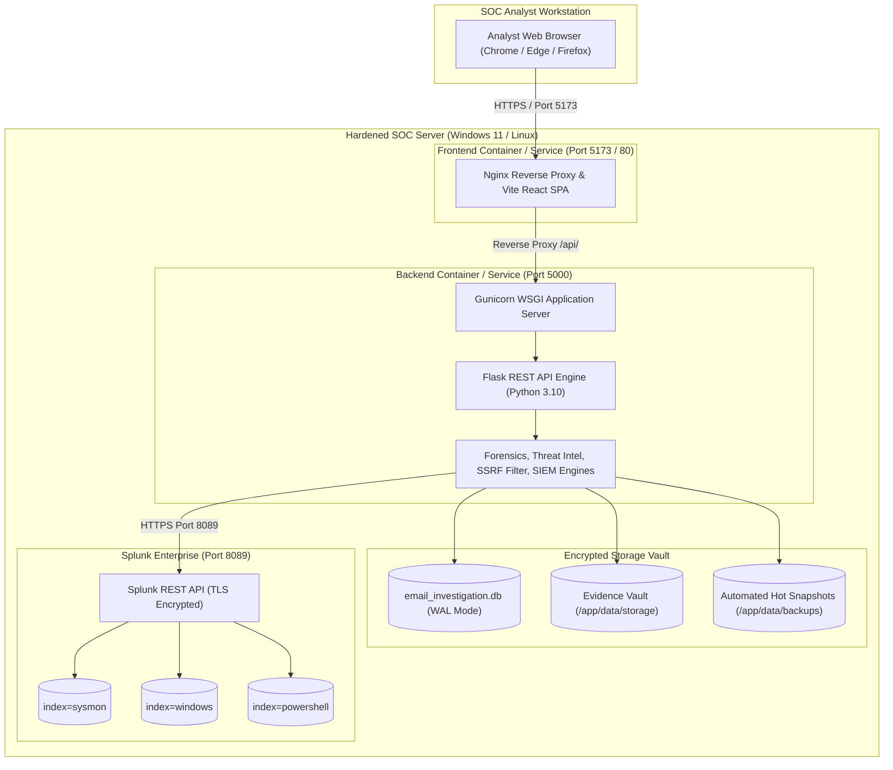

# Phase 7: PhishScope SOC — Production Deployment & Operations Guide

**Document Version**: 1.0.0  
**Effective Date**: 2026-11-06  
**Author**: Senior DevOps & Application Security Engineer  
**Classification**: TLP:AMBER | Internal SOC Operations  
**Project**: AI-Powered Automated Email Investigation & SOC Incident Correlation Platform (PhishScope SOC)  
**Status**: **VERIFIED**

---

## 1. System Overview & Deployment Topology

PhishScope SOC is deployed as a hardened, dual-tier application designed for on-premises enterprise SOC enclaves:



---

## 2. Docker Containerized Deployment

### 2.1 Prerequisites
- Docker Engine 24.0+ and Docker Compose v2.20+.
- Host operating system: Windows 11 / Windows Server or Ubuntu 22.04 LTS.
- Connectivity to Splunk Enterprise REST API on port 8089.

### 2.2 Quick Start
1. **Clone repository & prepare environment**:
   ```bash
   git clone <repo_url>
   cd Email_Investigation
   cp backend/.env.example backend/.env
   ```

2. **Configure production secrets in `backend/.env`**:
   Generate cryptographically secure 64-character hex keys:
   ```bash
   python -c "import secrets; print(secrets.token_hex(32))"
   ```
   Assign unique keys to `SECRET_KEY` and `JWT_SECRET_KEY`.

3. **Build and launch containers**:
   ```bash
   docker compose up -d --build
   ```

4. **Verify container health**:
   ```bash
   docker compose ps
   ```
   Both `phishscope_backend` and `phishscope_frontend` should report status `healthy`.

---

## 3. Bare-Metal & Windows Host Deployment

For direct execution on Windows hosts without Docker:

### 3.1 Backend Service
```powershell
cd C:\Users\YOGESH\Downloads\Email_Investigation\backend
python -m venv venv
.\venv\Scripts\Activate.ps1
pip install -r requirements.txt
python run.py
```
To run under production WSGI on Windows, use `waitress`:
```powershell
pip install waitress
waitress-serve --listen=127.0.0.1:5000 run:app
```

### 3.2 Frontend Service
```powershell
cd C:\Users\YOGESH\Downloads\Email_Investigation\frontend
npm install
npm run build
npm run preview -- --host 127.0.0.1 --port 5173
```

---

## 4. Production Environment Configuration Guide

| Variable | Description | Recommended Production Setting |
| :--- | :--- | :--- |
| `FLASK_ENV` | Runtime environment mode | `production` |
| `FLASK_DEBUG` | Debugger and traceback display | `0` (Strictly Disabled) |
| `SECRET_KEY` | Flask application secret | 64-character random hex string |
| `JWT_SECRET_KEY` | JWT signing secret | 64-character random hex string |
| `JWT_EXPIRATION_HOURS` | Session validity window | `8` |
| `ENABLE_AUTH` | Enforce JWT/API Key authentication | `true` |
| `CORS_ORIGINS` | Allowed frontend origins | `http://127.0.0.1:5173,http://localhost:5173` |
| `MAX_UPLOAD_SIZE_MB` | Maximum permitted file upload | `25` |
| `SPLUNK_HOST` | Splunk Enterprise REST API host | `127.0.0.1` |
| `SPLUNK_PORT` | Splunk Enterprise management port | `8089` |
| `SPLUNK_SSL_VERIFY` | Verify Splunk TLS certificate | `true` (or provide `SPLUNK_CA_BUNDLE`) |
| `SPLUNK_CA_BUNDLE` | Path to enterprise CA bundle | `/etc/ssl/certs/splunk-ca.pem` |

---

## 5. Health Checks & Monitoring

The platform provides standardized health check endpoints for load balancers and orchestrators:

- **Application Health**:
  ```http
  GET /api/health
  Host: 127.0.0.1:5000
  ```
  Returns `{"status": "healthy", "service": "phishscope-soc", "timestamp": "..."}`.

- **SIEM & Provider Connectivity**:
  ```http
  GET /api/siem/status
  Host: 127.0.0.1:5000
  ```
  Returns live connectivity status for Splunk, Wazuh, VirusTotal, AbuseIPDB, and OpenAI.

---

## 6. Disaster Recovery & Hot Backup Procedure

### 6.1 Creating a Hot Snapshot
Execute the non-blocking backup utility:
```bash
python backend/scripts/backup_db.py
```
- Performs a lock-free snapshot using `sqlite3.Connection.backup()`.
- Runs automatic `PRAGMA integrity_check;`.
- Output: `backend/data/backups/phishscope_backup_YYYYMMDD_HHMMSS.db`.

### 6.2 Restoring from Backup
```bash
python backend/scripts/backup_db.py --restore backend/data/backups/phishscope_backup_20261106_123157.db
```
- Verifies snapshot integrity before overwriting active database.
- Automatically preserves the prior database as `email_investigation.db.pre_restore.bak`.

